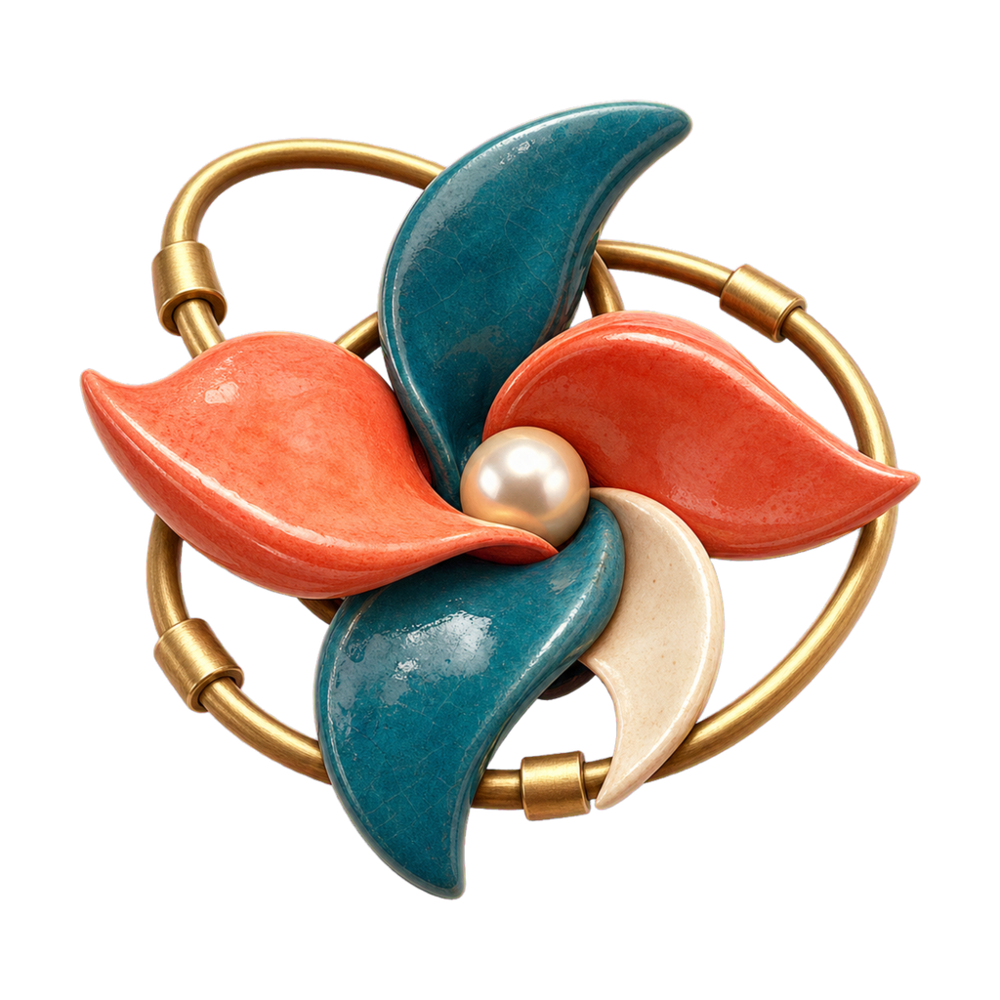
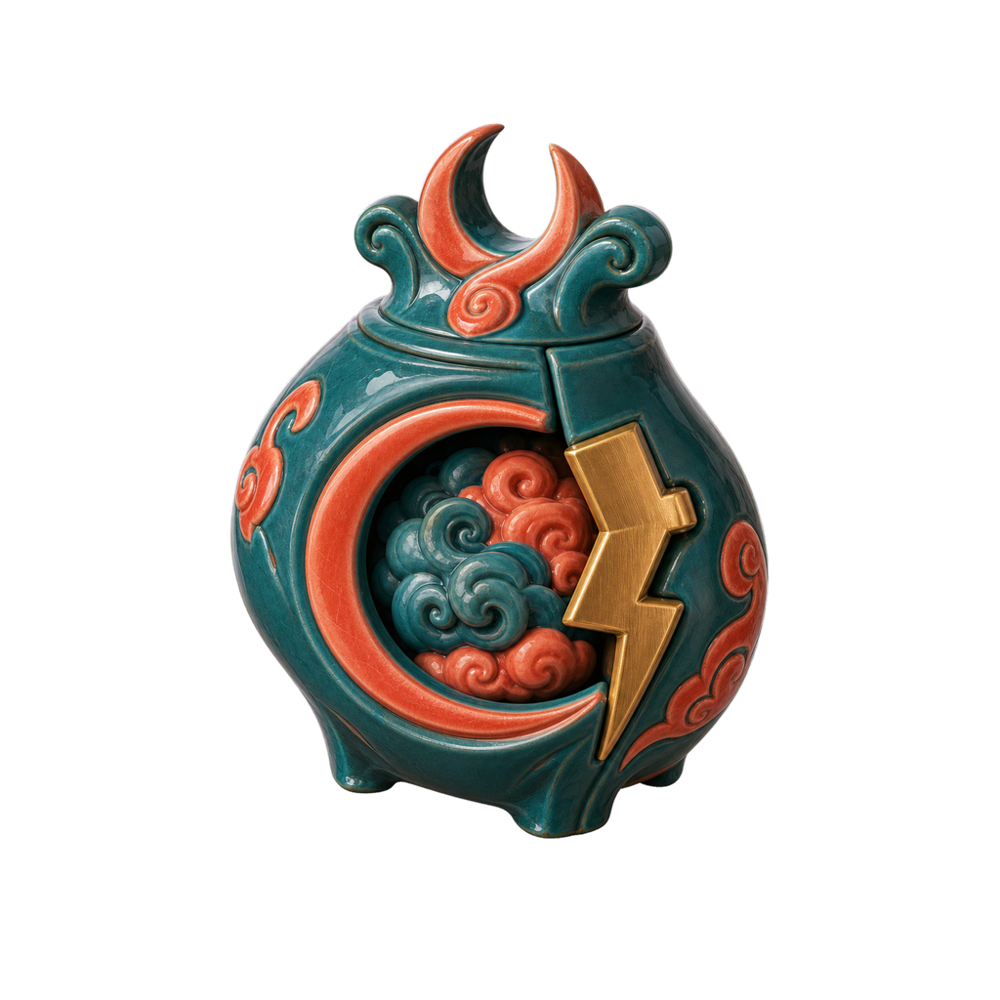
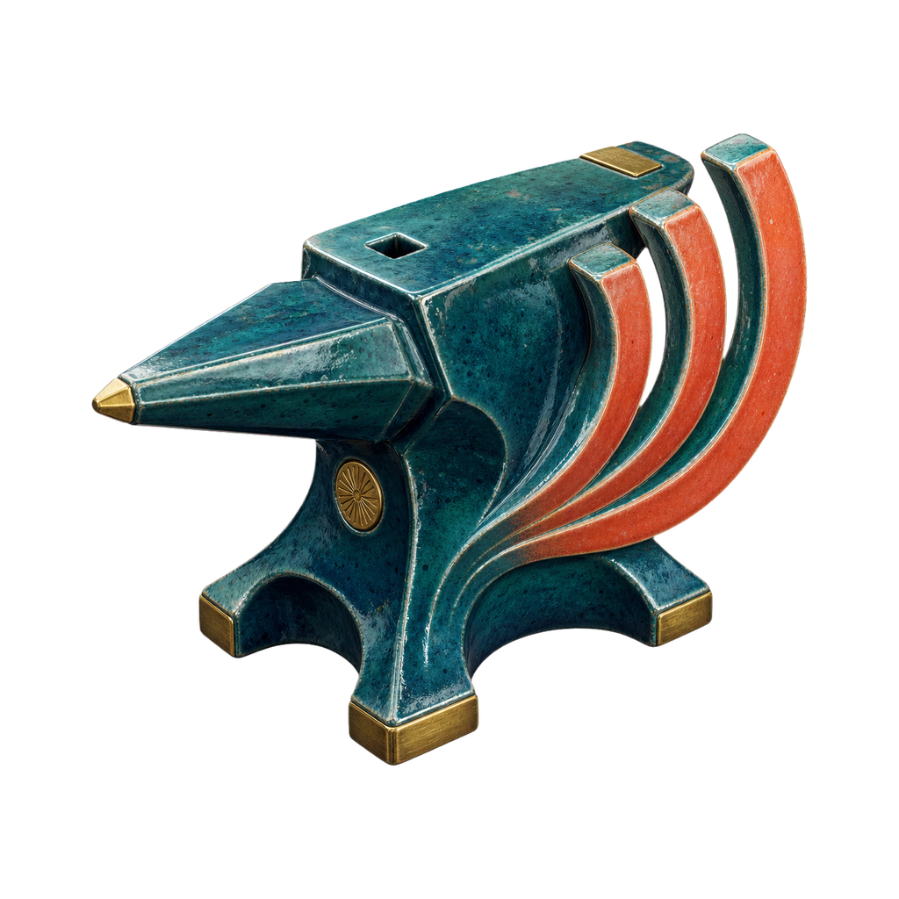
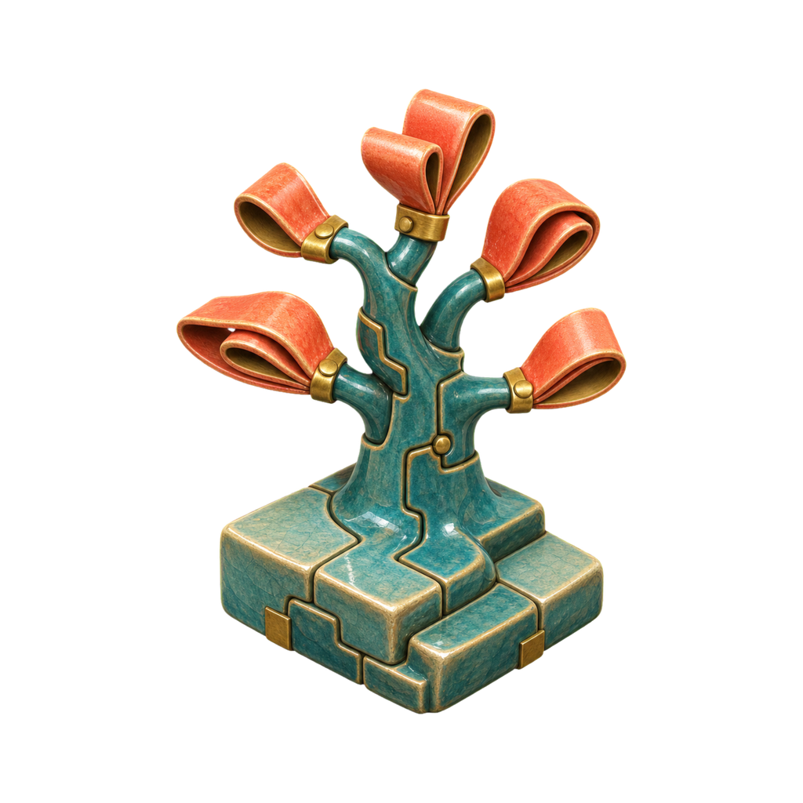
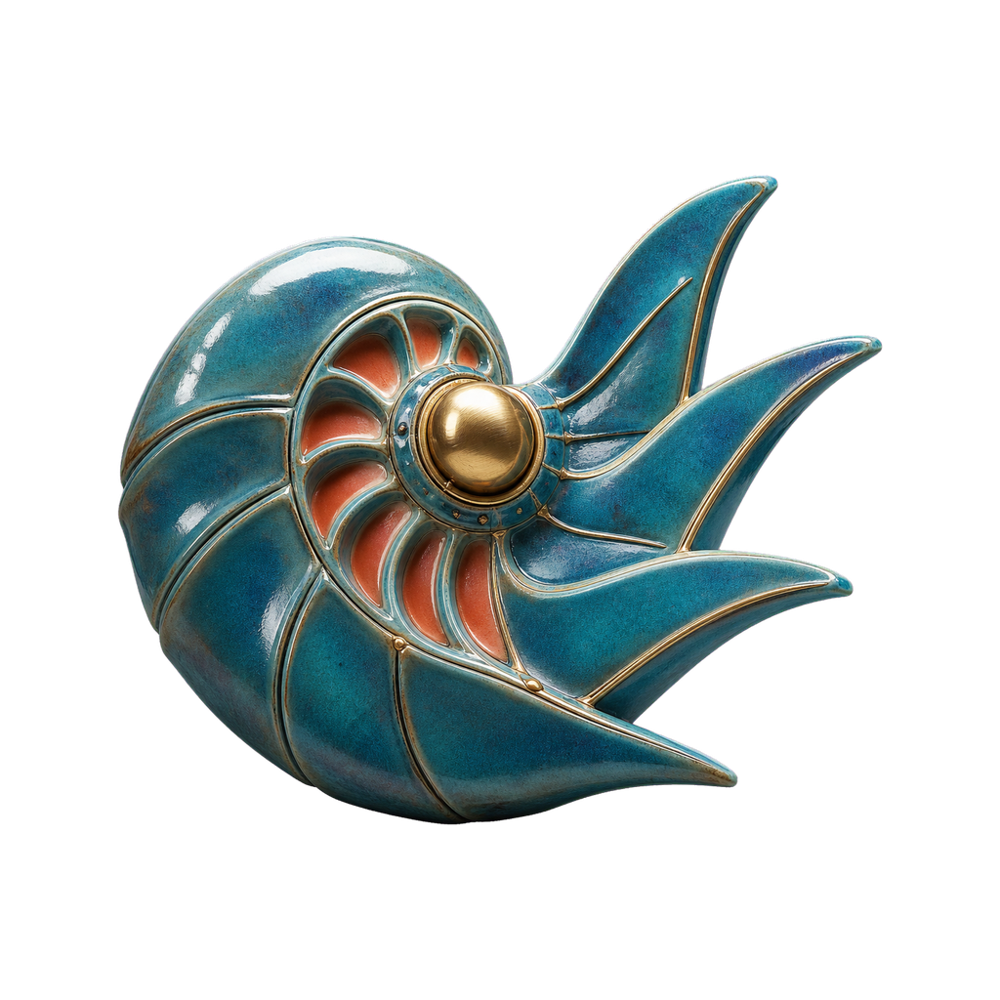
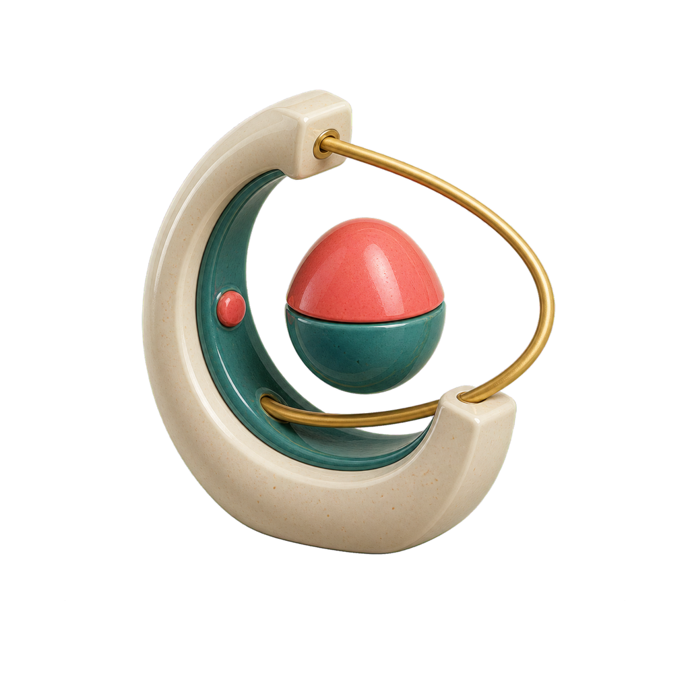
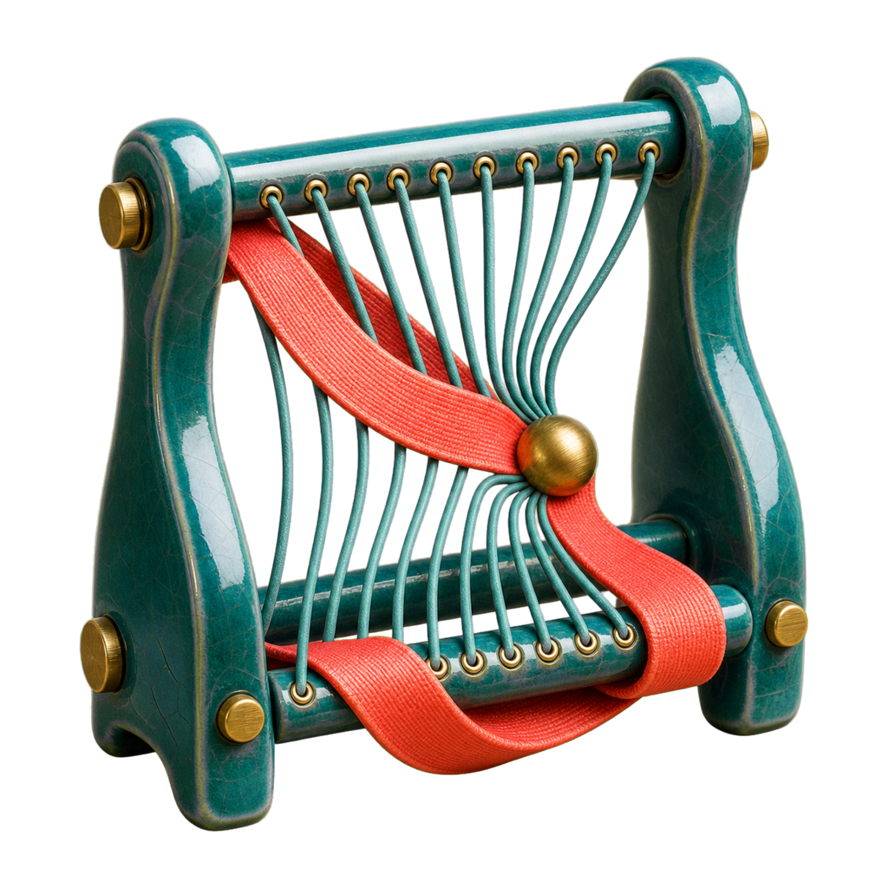
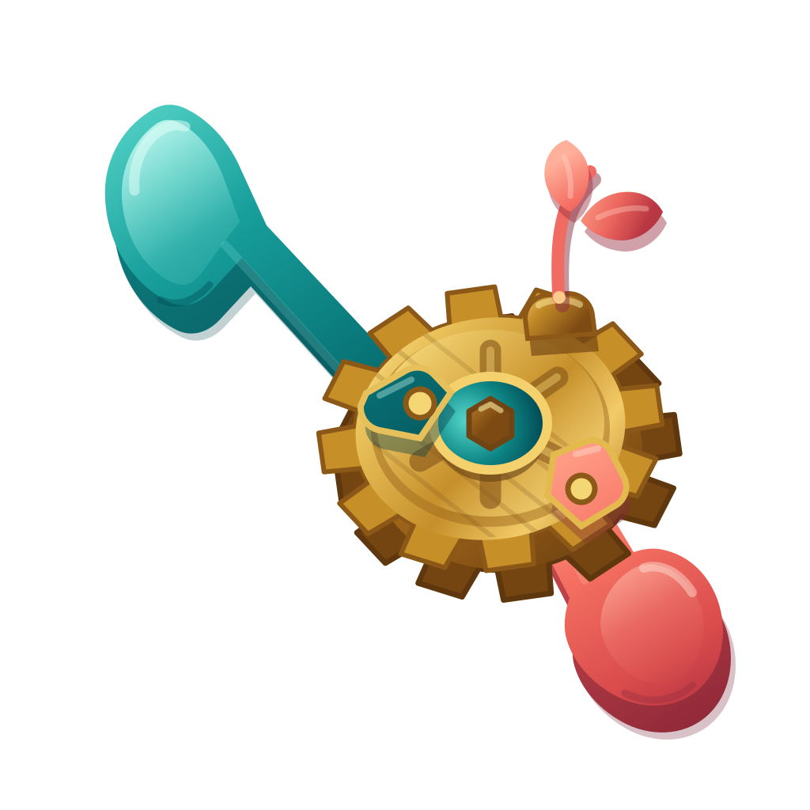
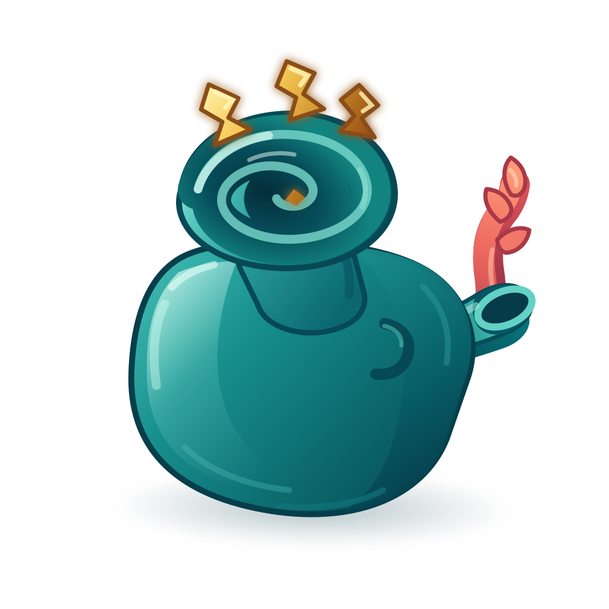
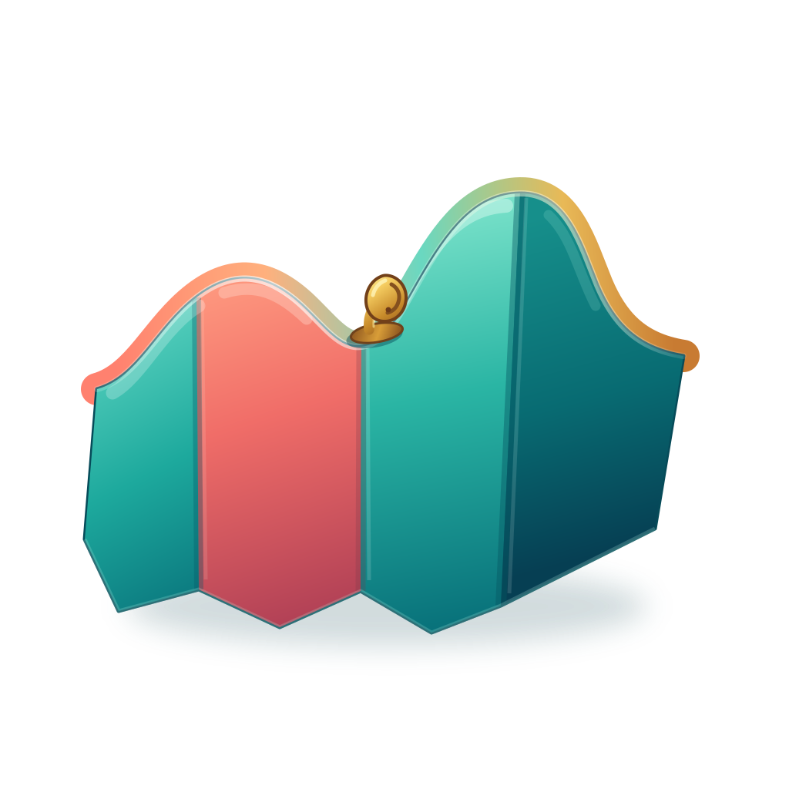

# Blind ten-agent custom icon evaluation

Ten fresh agents each received only the local `$custom-icons` skill, one original concept, and the same visual-family contract. They had no conversation history, could not inspect the repository gallery or one another's output, and worked in isolated temporary directories.

Shared direction: premium dimensional iconography, glazed ceramic and brushed-brass character, teal/coral/warm-gold palette, a memorable non-generic silhouette, transparent background, and no stock app-symbol shorthand.

| Icon | Concept and format |
| --- | --- |
|  | **01 — Chronobloom** · Transparent PNG A sculptural flower with orbital time-rings around a pearl-like seed. |
|  | **02 — Stormkeeper** · Transparent PNG A ceremonial lantern enclosing a curled storm cloud with a brass lightning clasp. |
|  | **03 — Echo Forge** · Transparent PNG An asymmetric anvil growing physical sound-ribbons from its struck edge. |
|  | **04 — Memory Orchard** · Transparent PNG A compact tree growing from archive tiles with folded memory-ribbon leaves. |
|  | **05 — Tide Compass** · Transparent PNG A nautilus-like shell whose chambers become directional tide fins. |
|  | **06 — Dream Relay** · Transparent PNG A crescent ceramic transmitter cradling a seed capsule through one brass orbit. |
|  | **07 — Gravity Loom** · Transparent PNG A weaving frame bending a coral ribbon around an off-center brass planet. |
|  | **08 — Kindness Engine** · Native SVG Two asymmetric paddles cooperatively turning a gear that grows a coral sprout. |
|  | **09 — Idea Cistern** · Native SVG A spiral ceramic vessel transforming captured brass sparks into a side-growing shoot. |
|  | **10 — Quiet Signal** · Native SVG A folded mountain ridge doubling as a calm waveform with a listening beacon. |

## Evaluation notes

- PNG outputs: `1024×1024`, RGBA, transparent corners.
- SVG outputs: self-contained `1024×1024` artboards with local resources only and no embedded raster imagery.
- Every final file passed the bundled structural validator. Visual quality and originality are intentionally left for human judgment.
